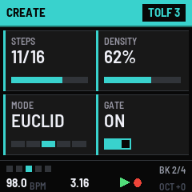

# RUN4 CTL

A firmware for the M-VAVE FM-1 that makes it a controller for the iOS app RUN4.

Keys, buttons, encoders and the MASTER knob go to RUN4 over USB-MIDI. RUN4 draws its pages on the FM-1's screen and
lights the LEDs. The keys play notes with velocity even when the app is not there.

* [Manual](manual/index.html)
* Install: the web installer (published by the project owner; TODO-OWNER).

Not affiliated with M-VAVE. GPL-3.0-only. Built on fm1-base and felucca-bsp.
